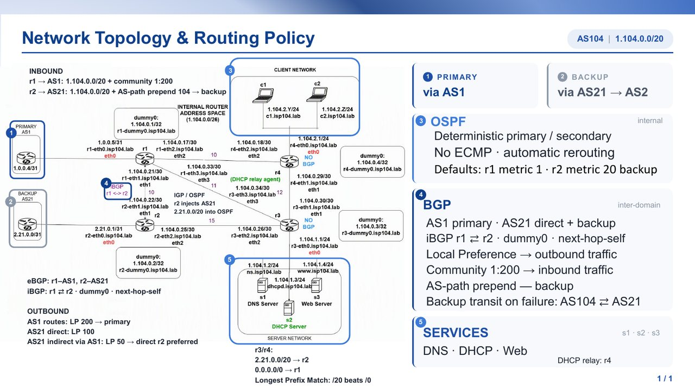

# ISP Network Lab — Kathará & FRRouting

A portfolio snapshot of an AS104 ISP implementation from a two-person university networking assignment. It contains the router, server, client, and startup configurations for a simulated ISP, plus a static topology overview for context. The complete shared Kathará base topology and other autonomous systems are intentionally excluded.

## Project overview

The lab configures an ISP with four routers, three servers, and two clients. The configuration combines:

- OSPF for internal routing and redundant paths
- eBGP/iBGP and route maps for upstream and neighboring-AS policy
- BIND DNS zones and resolver configuration
- ISC DHCP, a DHCP relay, and client startup scripts
- Apache-hosted service page
- Kathará device/link configuration and Linux startup commands

All addresses are values from an isolated educational virtual lab. Do not apply them to a live network.

## My contribution

This was a two-person group project. I implemented the router and service configurations, startup scripts, and configuration troubleshooting; I also reviewed the subnet plan and corrected an address-range issue. My teammate created the original topology drawing. The static image below is reproduced from the group presentation for project context and is not my drawing.

## Network topology



This is a static overview of the AS1 and AS21 upstreams, internal OSPF routers, client and server networks, and routing policy. It is not an executable Kathará topology file. Original topology drawing: teammate; image reproduced from the supplied group presentation.

## Repository layout

- `configs/` — AS104 router, server, and client configuration directories
- `scripts/` — startup scripts for AS104 devices
- `examples/lab.conf.as104` — AS104 device-to-link fragment to merge into the authorized lab template
- `docs/topology/` — credited static topology overview image from the group presentation

The service page uses placeholders instead of student names and email addresses. The original bundle also contained the shared template for other autonomous systems and course documents; those files have been excluded.

## Run in the course environment

1. Obtain the Kathará lab template through the course's authorized channel.
2. Copy the `configs/as104*` directories and `scripts/as104*.startup` files into the template's `project/` directory.
3. Add `examples/lab.conf.as104` to the template's `lab.conf` only if AS104 is the ASN assigned to your lab; keep the rest of the authorized topology intact.
4. Start the lab in the course VM:

   ```sh
   kathara lstart --noterminals
   ```

5. Use the course verification procedure to check routing, DNS, DHCP, and web reachability. This repository has not been run as a standalone lab; the original VM and base template are required for end-to-end verification.

## Resume wording (draft)

> Configured an ISP network lab with OSPF and BGP routing policies, BIND DNS, ISC DHCP/DHCP relay, and Linux service startup scripts in Kathará; reviewed and corrected subnet allocation in a two-person project.

## Language note

The supplied archive contains **no Java source files**. This project supports listing networking and Linux configuration experience; it does not support claiming Java implementation. Add Java to the CV only if you can point to a separate Java codebase and describe your own work in it.

## Coursework and attribution

This repository records my contribution to a group assignment. The shared starter template, assignment specification, assessment reports, editable source for my teammate's topology drawing, and other students' identifiers are not redistributed here. One static, credited overview image is included as group-project context. Please follow your course rules and do not submit this work as your own.

